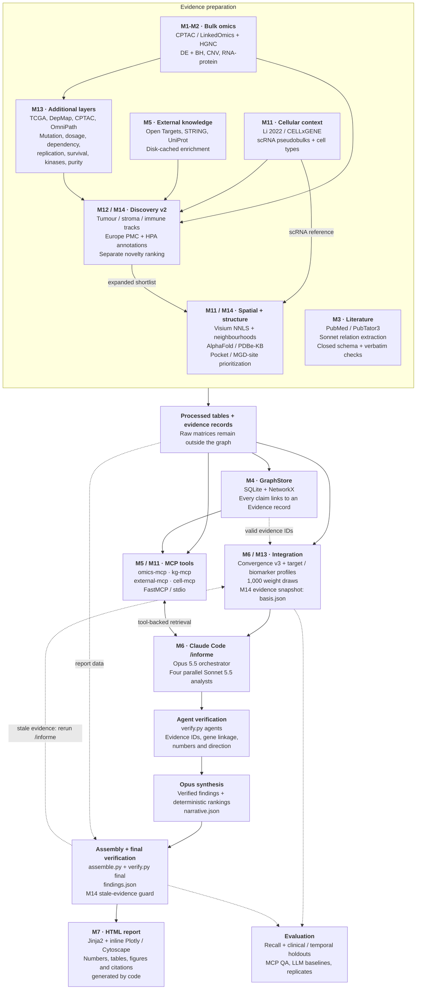

# Building an agentic multi-omics GraphRAG to prioritize targets in ccRCC — a case study

This repository documents **how to build** an agentic system that combines multi-omics data, literature
and external knowledge in an evidence-reified knowledge graph, and uses LLM agents to identify candidate
therapeutic targets and biomarkers, and why they matter. The disease is clear cell renal cell carcinoma
(ccRCC). It is an analysis and a worked example, not a general-purpose tool: paths, thresholds and choices
are specific to this question and these data.

> **Question:** *What are the candidate therapeutic targets and biomarkers in ccRCC with the strongest
> convergent evidence?*

Outputs: [`reports/ccrcc_report.html`](reports/ccrcc_report.html) (self-contained, open in a browser; 10 tabs) ·
[`evals/results.md`](evals/results.md) · [`evals/history.md`](evals/history.md) · [`PROGRESS.md`](PROGRESS.md)

## Design in one picture

Current architecture through **M14**. Code computes the statistics, rankings and report assets; Claude Code
extracts literature relations and writes interpretations grounded in the processed results and their evidence.



**How to read the diagram**

- **M13 combines complementary measurements with shared cohorts.** Somatic recurrence uses CPTAC + TCGA
  (cBioPortal; coding-length correction); CNV cis effects reuse CPTAC; dependency comes from DepMap;
  replication and univariate overall-survival analysis use TCGA-KIRC (Xena); protein-adjusted kinase activity
  uses CPTAC phosphosites + OmniPath; purity effects use CPTAC ESTIMATE. These layers feed the
  [configured convergence and profile components](config.yaml). The target and biomarker profiles exclude
  literature and drug history; convergence v3 still includes a literature stream.
- **Cell, spatial and structure results contextualize candidates; discovery has its own ranking.** M11 context
  and M12/M14 novelty scores do not enter convergence v3. Discovery combines bulk and scRNA evidence with
  tractability, clinical drugs, off-tumour expression, grade/stage, TCGA replication/prognosis, purity and
  dependency, and expands the spatial/structure shortlist. Spatial analysis uses fixed marker exclusions and
  per-gene seeded permutations. MGD scores prioritize sites; they do not demonstrate degradation.
- **Four analysis agents share four MCP servers.** `agente-omico`, `agente-literatura`, `agente-externo` and
  `agente-celular` run in parallel under `/informe`; `extractor-relaciones` is the separate M3 extraction
  subagent. Agent findings are checked before Opus writes the narrative, and the assembled findings are checked
  again before rendering. `basis.json` fingerprints evidence so changed values invalidate stale text.
- **Rebuild and LLM regeneration are separate operations.** `ccrcc run-all` rebuilds deterministic artifacts
  and revalidates saved extraction/agent outputs; `scripts/run_informe.sh` (or `.ps1`) regenerates the four-agent
  analysis and narrative. M3 relation extraction is a separate saved LLM step. Verification checks citation
  linkage, numeric/direction consistency and evidence freshness; it does not establish biological causality.

Implementation: [`cli.py`](src/ccrcc/cli.py) · [`discovery.py`](src/ccrcc/discovery.py) ·
[`integrate.py`](src/ccrcc/integrate.py) / [`scores.py`](src/ccrcc/scores.py) ·
[MCP configuration](.mcp.json) · [`/informe`](.claude/commands/informe.md) ·
[`verify.py`](src/ccrcc/verify.py) / [`provenance.py`](src/ccrcc/provenance.py) ·
[`render.py`](src/ccrcc/render.py)

## Key design decisions (and why)

| Decision | Rationale |
|---|---|
| Raw omics never enter the graph or a prompt | Statistics are computed once, deterministically (paired t-test + BH on matched cases). Agents query results through tools. |
| Evidence reification | `(gene)-[upregulated_in]->(ccRCC)` is stored only through an Evidence record (statistic, dataset, date). The SQLite schema enforces `evidence_id NOT NULL` + FK, so every sentence in the report can be traced. |
| PubTator3 instead of generic GraphRAG extraction | Entities come already normalized (NCBI Gene, MeSH). The LLM only extracts relations in a closed schema, and every relation must quote a sentence that is verified verbatim against the abstract. |
| Verification that is *gene-aware* | An agent claim about gene X is kept only if it cites evidence ids that exist **and** are attached to a claim involving X. A real id about another gene is rejected. |
| Convergence = independent evidence streams | Omics layers are combined into one stream so that differential expression alone (thousands of genes) cannot dominate. Weights live in `config.yaml`. |
| Two questions, two scores (M13) | "Is it a target?" and "is it a biomarker?" need different evidence. Both profiles leave out literature and drug history, so they can be evaluated against clinical outcomes without circularity. |
| Numbers are verified, not only ids (M13) | Every number an agent writes must exist in the evidence it cites, and up/down wording must match the cited omics evidence. This caught citation errors and stale numbers that existence checks had passed. |
| Robustness is reported, not assumed (M13) | Every rank comes with a 5th–95th percentile interval under 1,000 random re-weightings. |
| No paid API | All LLM work runs on Claude Code with a Pro subscription: subagents in `.claude/agents/`, orchestrator command `.claude/commands/informe.md`. |

## Data

- **CPTAC ccRCC discovery cohort** (LinkedOmics): 110 tumors; matched normals 75 (RNA), 84 (proteome, phosphoproteome); gene-level copy number. sha256 in `data/raw/manifest.json` (regenerated).
- **HGNC** complete set for identifier mapping (e.g. NDUFA4L2 is HGNC `COXFA4L2` today; the literature uses the old symbol).
- **PubTator3**: 319 abstracts (top 100 for the disease + 5 per top-50 omics gene), 7,270 normalized annotations; 100 abstracts used for relation extraction → 198 verbatim-validated relations.
- **Open Targets Platform** (MONDO_0005005): 1,998 associations with datatype scores; tractability, drugs and Reactome pathways for 371 genes. **STRING** (score ≥ 0.7). **UniProt** Swiss-Prot.
- **M13 layers** (sha256 in `data/raw/extra/manifest.json`): somatic mutations from cBioPortal (CPTAC renal and TCGA-KIRC PanCancer Atlas; 511 tumours), DepMap Public 26Q1 Chronos (24 clear cell RCC lines vs 1,184 others), TCGA-KIRC RNA-seq (72 tumour–normal pairs) and overall survival (533 patients) from UCSC Xena, CPTAC phosphosites (BCM pipeline) and ESTIMATE purity (cptac Zenodo record), OmniPath kinase–substrate relations, Open Targets 26.09 bulk tables (tractability for every target, clinical precedence with trial dates), GENCODE v22 coding lengths.

Raw CPTAC matrices and PubMed abstracts are **not redistributed** in this repository. The scripts download them again.

## Results (summary)

See the report for the full, cited analysis. Headlines (convergence v3, M13):
- Expected ccRCC biology is recovered: HIF targets CA9, NDUFA4L2, ANGPTL4, EGLN3 and VEGFA are strongly up in RNA (log2FC 2.9–6.8, padj < 1e-32) and replicate in TCGA-KIRC; 3p is the most frequently lost arm; somatic recurrence calls exactly VHL, PBRM1, BAP1, SETD2, KDM5C, MTOR, PTEN and TP53.
- **Candidates (orchestrator, Opus 5.5 + four Sonnet 5.5 agents):** CA9 (only gene robustly in the convergence top 10; tumour-intrinsic, replicated, phase 3 antibody), CD70 and NNMT, SCARB1 (most weight-robust target-profile call, little prior literature), ENPP3 and SLC16A3 (tumour-up and replicated), the biomarkers PSAT1, ALDH6A1, ALDOB and SLC22A8 (lost tubule genes; PSAT1/ALDH6A1 also prognostic), and EPAS1, promoted on clinical grounds (belzutifan) although its RNA barely moves.
- **Main caveat:** none of the expression-ranked targets is a selective DepMap dependency of ccRCC lines; EPAS1 is the only borderline one. They are targeting handles (antibody, ADC, radioligand), not genes the tumour needs.
- **Verification:** 91 statements in the final findings, 0 unsupported; the numeric check dropped 3 that quoted values not in the evidence they cited. Report validator: 414 claims, 1,364 evidence ids, all resolvable.
- **Evaluation** ([`evals/results.md`](evals/results.md), [`evals/history.md`](evals/history.md)): recall of 23 known ccRCC genes in the top 100 rises from 22 % (v2) to **39 %** (median rank 309 → 171). The data-only target profile ranks RCC clinical targets at AUROC 0.90 and a **temporal holdout** of targets first trialled in 2016 or later at 0.91 (4 of 13 in the top 100); predicted tractability alone gives 0.85, so the gain of the data layers is in early enrichment (17 % vs 4 % of clinical targets in the top 100). Known-answer QA with `claude -p` (Sonnet 5.5) and the MCP servers: **10/10**.
- **What the agents add:** a closed-book LLM gives the textbook list (60 % clinical targets, no evidence); the pipeline gives data-supported candidates with every statement verified, and three independent runs agree (Jaccard 0.94, same top 3).

> The current agent analysis is `runs/2026-11-01/` (M14), produced headless with `claude -p "/informe"` (Opus 5.5
> orchestrator, four Sonnet 5.5 subagents, project MCP servers); log in `runs/2026-11-01/informe_headless_m14.log`, and
> `basis.json` records the evidence values the agents saw. The M13 run and its replicates are in `runs/2026-10-31/` and
> `runs/replicates/`; older runs are in `runs/archive/`.

## Reproduce

Requirements: Windows/macOS/Linux, [uv](https://docs.astral.sh/uv/), Claude Code logged in with a Claude subscription (for the agent step only).

```bash
uv sync
uv run ccrcc run-all          # data → omics → M13 layers → literature → enrichment → graph → cells/structure/discovery
                              #   → convergence v3 + profiles + sensitivity → verify → HTML  (or: make all)
uv run pytest                 # tests (external calls are served from the disk cache after the first run)
uv run ccrcc eval             # recall, outcome gold sets, temporal holdout, robustness, baselines → evals/results.md
```

Agent step (Claude Code, no API key). It regenerates `runs/<date>/` with fresh agent analyses and narrative:

```bash
./scripts/run_informe.sh      # Linux / macOS (Windows: ./scripts/run_informe.ps1)
                              # = claude -p "/informe" --model claude-opus-5-5 --mcp-config .mcp.json --allowedTools ...
CCRCC_RUN_DIR=replicates/rep1 ./scripts/run_informe.sh   # a replicate run that does not touch runs/<date>/
uv run ccrcc baselines        # closed-book LLM runs, agent decisions vs ranking, replicate agreement
uv run ccrcc eval --qa        # + 10 known-answer questions answered by claude -p with the MCP servers
```

Approximate quota: one `/informe` run is one Opus orchestrator session plus four Sonnet subagents (~40 tool calls each);
the M13 evaluation used 3 agent runs, 3 closed-book calls and 10 QA calls.

Relation extraction (M3) is an LLM step done once with the `extractor-relaciones` subagent. Its validated output
(`data/literature/extracted/*.jsonl`) is versioned and re-validated on every run.

## Repository map

| Path | What it is |
|---|---|
| `src/ccrcc/omics.py` | Paired tumor-vs-normal DE, CNV frequencies, RNA–protein correlation, HGNC mapping |
| `src/ccrcc/literature.py` | PubTator3 ingestion, extraction batches, verbatim validation |
| `src/ccrcc/graph.py` / `kg_build.py` | `GraphStore` (SQLite + NetworkX) and graph construction |
| `src/ccrcc/mcp_servers/` | `omics-mcp`, `kg-mcp`, `external-mcp`, `cell-mcp` (FastMCP) |
| `src/ccrcc/singlecell.py` · `spatial.py` · `structure.py` · `kg_cell_structure.py` · `cell_context.py` | M11 cell-type, spatial and MGD layers |
| `src/ccrcc/discovery.py` · `safety_clinical.py` · `report_figures.py` | M12 target discovery, HPA safety, clinical association, report figures |
| `src/ccrcc/integrate.py` · `verify.py` · `assemble.py` · `render.py` | Convergence, verification, findings assembly, HTML |
| `src/ccrcc/extra_download.py` · `layers.py` · `kg_layers.py` | M13 downloads, statistics (mutations, cis dosage, DepMap, TCGA, phosphosites, kinases, purity) and graph loading |
| `src/ccrcc/scores.py` · `semantic.py` | M13 v3 components, target / biomarker profiles, sensitivity; numeric and direction verification |
| `src/ccrcc/outcomes.py` · `baselines.py` | M13 evaluation against clinical targets, temporal holdout and ClearCode34; agentic baselines |
| `src/ccrcc/provenance.py` | M14 stale-narrative guard (`basis.json`) |
| `.claude/agents/*.md` · `.claude/commands/informe.md` | Subagents (Sonnet 5.5) and orchestrator command |
| `config.yaml` | Thresholds, convergence weights (v3), profile weights, sensitivity settings |
| `evals/` | Known-answer questions, results, evaluation history |

## Moving to Neo4j

Only `GraphStore` touches storage. Implement the same methods (`add_node`, `add_evidence`, `add_claim`, `neighbors`,
`evidence_for`, `get_evidence`, `check_evidence_ids`, `resolve`, `stats`) over the Neo4j driver: nodes as labels,
Evidence as nodes, claims as `(:Entity)-[:SUBJECT_OF]->(:Claim {predicate})-[:OBJECT]->(:Entity)` with
`(:Claim)-[:SUPPORTED_BY]->(:Evidence)`. Agents, MCP servers and the report do not change.

## Cell-type, spatial and structural context (M11)

Added after the first full run, as annotation layers: they do **not** enter the convergence score (so recall@100 is unchanged
by construction, see `evals/history.md`). Data: Li et al. 2022 (*Cancer Cell*) via CZ CELLxGENE Discover, 178,817 scRNA-seq
cells (12 donors) and 38,836 Visium spots (23 sections); AlphaFold DB models; PDBe-KB ligand sites.

| Question | Method (`src/ccrcc/`) | Output |
|---|---|---|
| Which cell type expresses the target? Is the bulk signal tumor-intrinsic? | `singlecell.py`: donor x tissue x cell-group UMI pseudobulks streamed from the 1.6 GB h5ad; share of the gene's tumour transcripts per group; tumour cells vs normal proximal tubule, donor-paired t-test + BH | `sc_*.parquet` |
| Where is it expressed in situ and what surrounds it, weighted by abundance? | `spatial.py`: NNLS deconvolution with the study's own profiles (targets excluded from markers); NNLS of target CPM on cell shares; ring-1 neighbours of top-decile spots, observed/expected vs section-matched random spots, 1000 permutations, BH | `spatial_*.parquet` |
| Where could a molecular glue degrader bind? | `structure.py`: AlphaFold model trimmed at pLDDT 50, pyKVFinder cavities, MGD site score = confidence, pocket geometry, solvent-accessible lysines within 20 A (acceptor for E2~Ub), exposed non-helical loop (degron shape) | `structure_*` |

What the layers say (details and evidence ids in the report):

- **CA9** is tumour-intrinsic (97.6 % of its tumour transcripts come from tumour cells; log2FC 7.7 vs proximal tubule). **EGFR and MET** too.
- **KDR** is endothelial (95 % of its tumour transcripts); **CD74, CXCR4, PTPRC** are immune. Candidates ranked high by bulk expression that are
  not tumour-cell targets are now identified from data instead of suspected.
- **EPAS1** (HIF-2a) transcripts in this dataset are mostly endothelial and fibroblast (5 % tumour cells): interpret it as a pathway target (belzutifan), not as a tumour-cell expression marker.
- Spatial deconvolution is checked with held-out genes: CA9 vs tumour share rho 0.28, KDR vs endothelium 0.22, CD74 vs macrophage 0.33, positive but moderate.

**MGD scores are a prioritization of sites, not evidence that a degrader exists.** Honest validation against 23 proteins with experimental
ligand complexes: the cavity detector covers a median 44 % of ligand-bound residues; the score places the best-matching cavity first
in 11 of 23, but the top 3 pockets cover a median of only 10 %. A first version had a saturated lysine component (80 % of pockets at 1.0),
fixed from the component's distribution before interpreting any gene. No protein-specific E3 compatibility, ternary complex or
degron-sequence modelling is done; glue-degrader chemistry would need docking / cryo-EM follow-up.

New MCP server `cell-mcp` (celltype_expression, tumor_cell_vs_proximal_tubule, spatial_context, structure_pockets, mgd_ranking) and a
fourth subagent, `agente-celular` (Sonnet 5.5). Not used: Wu et al. 2023 snRNA/snATAC (dbGaP-controlled); GSE175540 / GSE156632 / Mendeley
`g67bkbnhhg` were checked as alternatives, but the CELLxGENE-curated copy of Li 2022 has harmonized Cell Ontology labels.

## Target discovery and the tabbed report (M12)

`src/ccrcc/discovery.py` screens genes that are up in tumor in both CPTAC RNA and protein and that scRNA-seq attributes mostly to one cell type
(tumor cell, stroma/vasculature or immune track), then annotates each with: ccRCC and overall literature volume (Europe PMC, symbol plus specific
aliases), clinical-stage drugs and tractability (Open Targets), UniProt location, vital-organ expression (Human Protein Atlas RNA, `safety_clinical.py`)
and correlation with histologic grade/stage (the CPTAC clinical file, unused until now). **Novel** = no clinical-stage drug and <= 15 ccRCC papers;
**first-in-class opportunity** adds small-molecule or antibody tractability and <= 50 nTPM in every vital organ. The shortlist also gets spatial and
structure analysis. Thresholds and weights are in `config.yaml`; the screen annotates and does not change the convergence score.

The report (`reports/ccrcc_report.html`, still one self-contained file) is now a tabbed atlas: Overview (KPIs, candidate cards), Candidates (stream
contributions, evidence heatmap), Omics (volcanoes, RNA-vs-protein, 3p loss, grade association), Cells & space (dot plot, tumour-transcript shares,
interactive Visium maps, neighbourhood heatmap), Structure & MGD (bubble chart, component breakdown, ligand-site validation, known-substrate controls),
Discovery (filterable table, spotlight cards, novelty map, off-tumor risk), Literature & drugs, Network, Methods & evidence (provenance, limitations,
roadmap, searchable evidence list). Light/dark theme, hash-based tab links and citations that open the right tab. `cell-mcp` gained `novel_targets` and
`discovery_profile`, and `agente-celular` writes the discovery paragraphs.

## Independent layers, two scores and outcome evaluation (M13)

Added after a review of v2. Everything numeric is deterministic code; weights were fixed before measuring.

| Change | Why | Result |
|---|---|---|
| Continuous omics (min(1, \|log2FC\| / cap) when significant) | 549 genes tied at a perfect binary omics component, so small streams decided the top 100 | 9 genes now reach ≥ 0.999 |
| CNV × cis effect (copy number vs own protein / RNA) | 3p loss gave the same bonus to ~490 genes | only genes whose dosage moves the product score |
| Somatic recurrence, CPTAC + TCGA-KIRC, length-corrected | The OT somatic datatype was a uniform 0.456 for many cancer-census genes | drivers recovered; TTN / MUC16 rejected |
| DepMap 26Q1 dependency, ccRCC lines vs the rest | Over-expression does not mean the tumour needs the gene | PAX8, HNF1B lineage dependencies; no top expression target is a dependency |
| TCGA-KIRC replication and survival | One cohort, no outcome | ρ = 0.81 between cohorts; prognostic genes flagged |
| Phosphosites → protein-adjusted kinase activity (KSEA, OmniPath) | Gene-level phospho hid the actionable signal | RPS6KB1 (mTOR axis) the most activated kinase |
| ESTIMATE purity: log2FC extrapolated to a pure tumour | Bulk changes can be infiltration | CD74 1.78 → 0.56, PTPRC 2.07 → 0.67; CA9 6.3 → 7.8 |
| scRNA `cpm_share` (per-cell level, abundance-independent) | Transcript shares depend on how many cells of each type were captured | reported next to the transcript share |
| Target and biomarker profiles; 1,000-draw weight sensitivity | One score answered two questions; ranks had no uncertainty | robust calls separated from weight-dependent ones |
| Numeric and direction verification of every statement | Ids were checked, content was not | 22 / 96 statements of the M11-era run fail; 3 / 94 in the new run, dropped |
| Outcome evaluation: RCC clinical targets, temporal holdout (≥ 2016), ClearCode34 | Recall of a mixed known-gene list is partly circular | target profile AUROC 0.90 / holdout 0.91, with a tractability-only control |
| Closed-book LLM baseline and replicate runs | The value of the agentic layer was asserted, not measured | see `evals/results.md` (d) |

## Reproducibility guard and discovery v2 (M14)

- **Spatial statistics no longer depend on which genes are analysed.** One random generator per gene (seeded from the
  gene symbol) and a fixed marker-exclusion set for the deconvolution; previously a different discovery shortlist
  changed every gene's neighbourhood numbers. Checked by re-running with another target list: identical results.
- **Stale-narrative guard.** `runs/<run>/basis.json` fingerprints every evidence record the agents could cite when the
  agent step starts; `verify.py final` fails any statement whose cited evidence changed since, and asks for a new
  `/informe`. A full `run-all` on top of the M14 run reports 0 stale statements, so rebuilding alone does not trigger it.
- **Gene-level summary records** (`sc_summary`, `spatial_summary`) let one evidence id support a sentence that compares
  several cell groups; before, the numeric check kept rejecting such sentences and the report lost its spatial text.
- **Discovery v2.** TCGA replication, purity-robust up-regulation (tumour and stroma tracks), adverse prognosis and
  DepMap dependency enter the novelty score; first-in-class also needs replication and, outside the immune track, a
  purity-robust change. Lists, cards and the table are per track; immune genes that vanish at purity 1 are labelled
  infiltration-driven. 60 first-in-class candidates: immune 54, tumour 3 (COL23A1, RAB42, COL8A1), stroma 3.

## Limitations

External replication is RNA-only (TCGA-KIRC); a second proteogenomic cohort would replicate protein and phosphosites. Bulk tissue
(infiltration now quantified by scRNA-seq and purity extrapolation, which assumes a linear purity effect);
DepMap ccRCC lines are few (24) and grown in normoxia, so HIF-dependent biology is under-represented;
scRNA-seq / Visium come from a different cohort than CPTAC (12 donors; dissociation bias favours immune cells; Visium spots hold several cells);
MGD sites are heuristic and weakly validated (see above);
outcome gold sets are small (13 holdout targets; wide confidence intervals) and clinical targets are mostly druggable by construction;
literature corpus limited and biased toward omics-selected genes; Open Targets
evidence includes non-specific pan-cancer scores; LLM steps are not bit-reproducible (their outputs are saved and
verified). Not medical advice.
