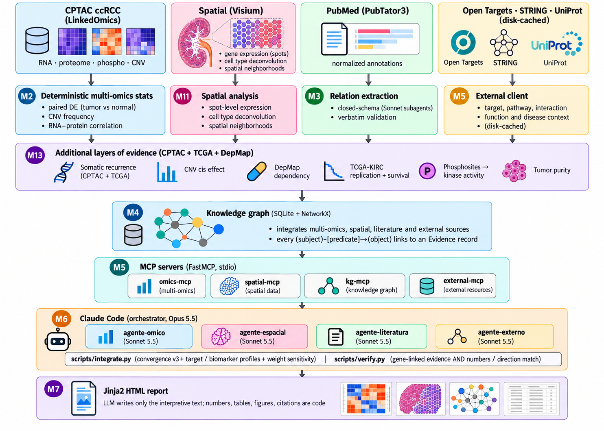

# Agentic Multi-omics Target Atlas for Kidney Cancer

**A reproducible, evidence-based screen for drug targets and biomarkers in clear cell renal cell carcinoma (ccRCC).**

## Explore the interactive atlas

### [Open the live report →](https://rsolerortuno.github.io/agentic-kidney-atlas/)

**Browse the candidate targets, inspect the evidence, explore tissue maps and rotate protein structures in 3D.** The report opens directly in your browser; no installation is needed. Use the navigation tabs and the help buttons to explore each analysis.

[](https://rsolerortuno.github.io/agentic-kidney-atlas/)

---

**[Read the step-by-step project walkthrough](https://rsolerortuno.github.io/projects/agentic-kidney-atlas.html)** — how the agents work, how to read all 13 report tabs, the 3D and tissue viewers, results and limitations.

[Reproduction guide](docs/reproduction.md) ·
[Limits of the automatic checks](docs/numeric-claims.md) ·
[Evaluation results](evals/results.md) ·
[Change history](evals/history.md)

## Summary

Clear cell renal cell carcinoma is the most common kidney cancer. Existing drugs help many patients, but most
eventually stop responding, so researchers look for new drug targets and for markers that tell patients apart.

This project screens about 19,000 human genes against that goal. For each gene it combines many independent kinds of
public evidence: how the gene changes in tumours compared with healthy kidney, whether a second patient cohort agrees,
which cell type makes it, whether cancer cells depend on it, how it relates to treatment response and survival, and what
the literature and drug databases already say. A gene is a good candidate when several unrelated lines of evidence agree.

All statistics are computed by code. AI agents (Claude) only choose what to look at and write short explanations, and a
separate checker verifies every sentence against the stored evidence. The output is a ranked list and a self-contained
interactive report with a help button on every figure and table.

**Status.** This is a research prototype built on public data. It generates hypotheses. It has not been tested in the
laboratory or in patients, and it is not medical advice. The limits are listed in [section 8](#8-limits-and-open-issues).

## Contents

1. [Scientific background](#1-scientific-background)
2. [How the method works](#2-how-the-method-works)
3. [Data sources](#3-data-sources)
4. [Methods in brief](#4-methods-in-brief)
5. [Main results](#5-main-results)
6. [How the results were checked](#6-how-the-results-were-checked)
7. [Reproducing the analysis](#7-reproducing-the-analysis)
8. [Limits and open issues](#8-limits-and-open-issues)
9. [Repository map](#9-repository-map)
10. [Glossary](#10-glossary)

## 1. Scientific background

Almost every ccRCC tumour has lost a gene called *VHL*. Without it the cell behaves as if it were short of oxygen, and a
protein called HIF-2α stays switched on. One approved drug, belzutifan, blocks HIF-2α. Other approved drugs block blood
vessel growth (for example sunitinib) or release the immune system (for example nivolumab).

Two kinds of discovery matter here:

- A **target** is something a drug can act on. A good target is higher in tumours than in healthy tissue, made by the
  cells you want to hit, reachable by a drug, and not needed by vital organs.
- A **biomarker** is something you can measure to tell patients apart, for example to predict who will do better.

A target and a biomarker need different evidence, so the project scores them separately.

## 2. How the method works



The idea is **convergence**. Any single test can mislead, so a gene is ranked highly only when independent kinds of
evidence point to it. There are four stages.

1. **Measure (code only).** Python scripts run the statistics: tumour against matched healthy kidney, copy number,
   mutations, other cohorts, clinical trials, single cells, tissue slices, cell-line screens and drug databases. No
   language model sees raw data or computes a number.
2. **Store with receipts.** Every result is saved in a knowledge graph as a *claim* attached to an *evidence record*
   that holds the value, the dataset and the date. The database refuses a claim without an evidence record.
3. **Interpret (AI agents).** Five agents with limited tools read the graph and write short findings: omics,
   literature, external databases, cell context and translational questions (treatment response, subtypes, antibody
   conjugates, immune environment, replication). An orchestrator selects candidates and writes the summary.
4. **Verify.** A checker tests each sentence: the cited record must exist and belong to the same gene, each number must
   match one specific field of that record with its sign and unit, the up or down wording must agree with the data,
   and the record must not have changed since the agent read it. Sentences that fail are removed.

The checker reports "no failures detected by the automatic checks". That is not proof that every interpretation is
correct; see [docs/numeric-claims.md](docs/numeric-claims.md).

## 3. Data sources

All data are public. Files are listed with checksums in [reproducibility/inputs.json](reproducibility/inputs.json).

| Evidence | Source | Size or scope |
|---|---|---|
| Tumour vs normal: RNA, protein, phosphorylation, copy number | CPTAC ccRCC discovery cohort (LinkedOmics) | 110 tumours; matched normals: 75 (RNA), 84 (protein, phospho) |
| Replication of protein and phosphosites | CPTAC ccRCC confirmatory cohort, label-free mass spectrometry (Proteomic Data Commons, PDC000411) | 111 further tumours, about 86 matched pairs |
| Somatic mutations | cBioPortal: CPTAC and TCGA-KIRC | 511 tumours |
| RNA and survival in a second cohort | TCGA-KIRC (UCSC Xena) | 72 tumour-normal pairs; 533 patients with survival |
| Cell-line dependency | DepMap 26Q1 CRISPR screens | 24 ccRCC lines against 1,184 others |
| Tumour purity, immune cell estimates | CPTAC ESTIMATE, CIBERSORT, xCell (cptac Zenodo record) | 110 tumours |
| Phosphosite and kinase activity | CPTAC phosphosites, OmniPath kinase-substrate links | Site-level tumour vs normal, turned into inferred kinase activity |
| Single cells | Li et al. 2022 and Zhang et al. 2021 (CZ CELLxGENE) | 178,817 and 20,509 tumour cells |
| Tissue slices | Li et al. 2022, 10x Visium | 16 sections, 38,836 spots; four sections with the microscope image |
| Treatment response | IMmotion150 (263 patients) and Choueiri 2016 (16 patients), cBioPortal datahub; CheckMate 025 (Braun et al. 2020, 250 patients, nivolumab vs everolimus) | RNA before treatment, progression, response |
| Literature | PubTator3, Europe PMC | 319 abstracts; 198 relations that were checked word for word |
| Drugs and druggability | Open Targets 26.09, ChEMBL, UniProt, Human Protein Atlas | Clinical stage, tractability, surface location, normal-tissue staining |
| Cell-surface proteins | SURFY (in-silico surfaceome) and the Cell Surface Protein Atlas (mass spectrometry) | Whether a protein is really on the cell surface |
| Protein in normal organs | GTEx proteome (Jiang et al. 2020) | 32 tissues, 12,627 proteins; enrichment in vital organs |
| Drug response of cell lines | PRISM Repurposing 20Q2 (DepMap) | 10-14 ccRCC lines against about 550 others, 5,274 compound treatments |
| Protein structures | AlphaFold DB, PDBe-KB, curated experimental references | Used for descriptive context only |

## 4. Methods in brief

- **Tumour vs normal.** Paired t-test on matched samples, with Benjamini-Hochberg correction for multiple testing.
- **Convergence score.** Seven evidence streams (omics, copy number with its effect on the gene product, literature,
  genetics, tractability, cell-line dependency and replication in a second cohort), each scaled from 0 to 1 and
  multiplied by a weight set in [config.yaml](config.yaml) before the results were examined.
- **Two profiles.** A *target* profile and a *biomarker* profile use measurements only, without literature or drug
  history, so they can be tested against clinical outcomes without circularity.
- **Stability.** Each rank comes with a 5th to 95th percentile interval from 1,000 random re-weightings.
- **Cell context.** Pseudobulk comparison of tumour cells with proximal tubule, per-donor; tissue spots deconvolved
  against the study's own cell profiles; neighbour enrichment tested by permutation.
- **Treatment response.** Cox regression of progression on expression per trial arm, and the difference between arms
  on one expression scale (equivalent to an arm x gene term with arm-stratified baselines), with two published
  signatures as positive controls (each must be in the published direction with p < 0.05).
- **Subtypes.** Mutant against wild type for VHL, PBRM1, BAP1 and SETD2, and ccA against ccB from the ClearCode34 genes.
- **Antibody and radioligand suitability.** Surface topology, increase in tumour, staining in vital normal tissues and
  how evenly tumour cells express the gene.
- **Structure.** Descriptive features of predicted pockets, plus curated experimental references. The pocket score is
  not a prediction of whether a protein can be degraded.

## 5. Main results

Numbers come from the saved, reviewed analysis (`runs/2026-11-03`). The report gives the detail and the caveats.

**Known biology is recovered.**
HIF target genes (CA9, NDUFA4L2, ANGPTL4, VEGFA) are strongly up and replicate in the second cohort. (NDUFA4L2's current
HGNC symbol is COXFA4L2; before 2026-11-03 the pipeline missed its TCGA replication because TCGA uses the old symbol, see
`docs/reproduction.md`.) Loss of
chromosome arm 3p is the most frequent copy-number change. The mutation test calls VHL, PBRM1, BAP1, SETD2, KDM5C,
MTOR, PTEN and TP53.

**Candidates.**
CA9 and NDUFA4L2 (COXFA4L2) are the only genes that stay in the top ten in at least 80 % of 1,000 random re-weightings
(89 % and 88 %); no gene stays there under every weighting. The main target calls are CD70, NNMT, ENPP3, SCARB1 and
SLC16A3. The main biomarker calls are PSAT1 and PCK1, with ALDOB and other kidney genes that the tumour loses. No expression-based target is a gene the cancer cells depend on, so these are handles for antibodies, conjugates
or radioligands, not weak spots of the cell.

**Unexplored candidates.**
The ranking above favours genes that are already well studied. A separate discovery screen looks for the opposite: genes
that rise in tumours, are made mainly by one cell type, have few ccRCC papers and no clinical drug. The best tumour-cell
candidates are COL23A1 and RAB42. For each one the report says what supports it (higher in tumour in two cohorts, made by
tumour cells, still present at full tumour purity) and what is missing (staining in normal tissue, a selective dependency,
confirmatory proteomics). They are hypotheses prioritised for experimental validation, not discoveries: earlier preclinical
work may exist, because "novel" here only means at most 15 ccRCC papers and no clinical drug.

**Replication.**
In the confirmatory cohort, 79 % of the protein changes and 73 % of the phosphosite changes found in the discovery
cohort appear again in the same direction (fold changes correlate at 0.89 and 0.83). Some genes cannot be tested there:
CA9 and CD70 are too sparse in normal kidney in the label-free data. HK2 does not replicate.

**Treatment response.**
Two published signatures reproduce in IMmotion150, which shows the data are usable. Many genes associate with
progression inside one arm, but no gene separates immunotherapy from sunitinib after correcting for 20,000 tests, and no
gene separates nivolumab from everolimus in CheckMate 025 either.

**Subtypes.**
PBRM1 and BAP1 mutations change far more genes than VHL. ccB tumours carry a hazard ratio of about 2.3 for death in
TCGA.

**Antibody and radioligand targets.**
Known targets CD70, HAVCR1, CA9 and ENPP3 rank 2, 4, 13 and 39 among 2,017 tumour-up genes.

**Immune environment.**
PDCD1 ranks 10th in the immune-target profile, but only 1 of 7 checkpoint controls reaches the top 100, so this profile
lists candidates and is not a validated ranking.

## 6. How the results were checked

| Check | Result |
|---|---|
| Recall of 23 known ccRCC genes in the top 100 | 39 % (median rank 176 of 19,161 genes) |
| Target profile against 75 clinical RCC targets | AUROC 0.90; predicted tractability alone gives 0.86, so the gain is in early enrichment. Without Open Targets' "High-Quality Ligand" bucket (ChEMBL chemistry, i.e. drug-discovery history) the profile gives 0.80, so much of the headline is known chemistry |
| Retrospective test on 6 targets first trialled in 2016 or later | AUROC 0.89 (0.67 without the ligand bucket); 1 of the 6 in the top 100. Three of the six are PARP1/2/3 (one drug class), so this is about four independent targets and the interval is optimistic. Features are not frozen before 2016, so this is retrospective, not prospective |
| Biomarker profile against ClearCode34 genes | AUROC 0.74 |
| Known-answer questions answered with the project's tools | 10 of 10 |
| Agent text against its evidence | 118 statements checked, no failures detected by the automatic checks |
| Deliberately corrupted copies of those statements | Caught: 100 % of changed numbers, other-gene attributions and swapped evidence; 74 % of flipped directions where the sentence cites expression evidence, 28 % of all flipped directions (literature and treatment sentences are not direction-checked) |
| Report validator | 451 claims, 1,653 evidence records, all resolvable, no external resources |
| Agents against a model answering from memory | The memory-only model gives the textbook list (60 % clinical targets, nothing citable); the pipeline gives data-backed candidates |
| Repeat agent runs | Mean overlap (Jaccard) 0.86 between the final target lists of three runs. The overlap mostly reflects the shared deterministic ranking |
| Agents against a list taken straight from the rankings | Overlap 0.53 with a same-length list alternating target profile, biomarker profile and discovery screen; the agents add ENPP3, EPAS1, COXFA4L2 and ALDOB and leave out ALDH6A1, TNFAIP6, SLC6A19 and FABP6 |
| Single agent against multi-agent ([interpretation](benchmarks/architecture_v2/README.md), [full pipeline](benchmarks/architecture_pipeline/README.md)) | Interpreting given evidence (24 masked dossiers): one agent answered everything correctly; specialists with or without an orchestrator were never more accurate and cost 1.3–2.9 times as much. Full pipeline with MCP retrieval (2 runs per arm): same quality (0 unsupported statements, 10–12 of 13 checklist facts in both), but the multi-agent pipeline cost about 40 % less ($3.60 vs $5.95) and took 5 instead of 45 minutes. Optimization: validated structured output removed every broken answer (the orchestrator design then also scored 100 %), and a coverage step that keeps the specialists' key findings in the report raised the multi-agent checklist to 13 and 12, matching the single agent, at $4.35 and 8 minutes per run |

A control is a known case scored the same way as the candidates. Known antibody targets rank near the top. Known
immune checkpoints rank unevenly, and the report says so.

## 7. Reproducing the analysis

You need [uv](https://docs.astral.sh/uv/). The agent step also needs Claude Code logged in with a subscription (no API key).

```bash
uv sync --frozen
uv run python -m ccrcc.reproducibility   # check the retained input snapshot against its hashes
uv run ccrcc run-all                     # rebuild everything deterministic, offline, from frozen inputs
uv run pytest                            # automated tests
uv run ccrcc eval                        # evaluation against clinical targets, robustness, baselines
```

By default the rebuild runs offline from the frozen snapshot, and refuses to run if an input file has changed. A fresh
download from the original sources is not guaranteed to give the same bytes, because providers update their releases.
Language-model outputs are saved as inputs and are not regenerated by this rebuild. The step-by-step guide, and the
evidence from a clean-machine run in which 43 result tables matched exactly, are in
[docs/reproduction.md](docs/reproduction.md).

To regenerate the agent findings and the summary (about half an hour, uses a Claude subscription):

```bash
./scripts/run_informe.sh        # Windows: ./scripts/run_informe.ps1
```

The online report is published automatically from `reports/ccrcc_report.html` by
[.github/workflows/pages.yml](.github/workflows/pages.yml).

## 8. Limits and open issues

- **Public data from a few cohorts.** Nothing here was validated in the laboratory or in patients.
- **Bulk tissue mixes cells.** Single-cell data and purity corrections help, but they come from other patients than the
  CPTAC cohorts and from few donors, and tissue dissociation favours immune cells.
- **Cell-line dependency** uses 24 ccRCC lines grown in normal oxygen, so it understates the biology of low oxygen.
- **Treatment-response tests are weak.** One adequately sized trial, about 90 patients per arm, and no gene that separates
  the two main arms.
- **Gaps are not failures.** A gene missing from the confirmatory proteome (CA9, CD70) is untested, not unreplicated.
- **The structure layer is descriptive.** The pocket score describes features of a single predicted protein. It does not
  predict degradability, and recovering known ligand sites only tests cavity detection.
- **Clinical gold sets are small**, and clinical targets are mostly druggable by construction.
- **Agent text is not bit-for-bit repeatable.** Its outputs are saved and checked, and the checks have limits described in
  [docs/numeric-claims.md](docs/numeric-claims.md).
- **No licence file yet.** Add one before reusing the code or the report.

**Decisions made after seeing data** (not pre-registered, logged with their effect in
[evals/history.md](evals/history.md)):

- A selective dependency needs at least three dependent ccRCC cell lines out of 24.
- Literature counts use only gene names that belong to a single gene, and potent compounds or patents in ChEMBL halve
  the "undrugged" credit.
- A clinical-precedence term was removed from the target profile because it leaked the answer into the evaluation.
- The number check was made stricter after it let a wrong number through.
- Repeat agent runs start from a clean folder and read the same folder as the main run.

## 9. Repository map

```
config.yaml          thresholds and weights, set before looking at results
src/ccrcc/           the code
scripts/             commands used by the agent step
.claude/agents/      the five agents and the literature extractor
.claude/commands/    the orchestrator command
data/                downloaded data and results (not in git)
reproducibility/     frozen input list, hashes and clean-run evidence
runs/                saved agent outputs and their verification
evals/               evaluation results and the history of changes
docs/                reproduction, verification limits, audit
reports/             the final HTML report
tests/               automated tests
```

| Code in `src/ccrcc/` | What it does |
|---|---|
| `omics.py`, `layers.py`, `confirmatory.py` | Tumour-vs-normal statistics; mutations, copy-number effects, dependency, TCGA, phosphosites, purity; the confirmatory cohort |
| `treatment.py`, `subtypes.py`, `adc.py`, `immune.py` | Treatment response, subtypes, antibody-conjugate suitability, immune environment |
| `singlecell.py`, `sc_replication.py`, `spatial.py`, `spatial_viewer.py` | Cell types, the second single-cell dataset, tissue neighbourhoods, tissue viewer data |
| `structure.py`, `degradation.py`, `protein_viewer.py` | Descriptive pocket features, curated experimental references, 3D viewer |
| `discovery.py`, `safety_clinical.py`, `external.py` | Discovery screen, vital-organ expression, Open Targets, ChEMBL, Europe PMC |
| `m16.py`, `xlsx.py` | Surfaceome, normal-tissue proteome, CheckMate 025 and PRISM; a small reader for supplementary spreadsheets |
| `literature.py`, `literature_entities.py` | PubMed ingestion and checked relation extraction |
| `graph.py`, `kg_*.py` | The knowledge graph and its loaders |
| `scores.py`, `integrate.py` | Convergence score, target and biomarker profiles, weight sensitivity |
| `verify.py`, `semantic.py`, `provenance.py`, `assemble.py` | Sentence checks and the stale-text guard |
| `mcp_servers/` | The tools the agents use |
| `outcomes.py`, `baselines.py`, `evaluate.py`, `sabotage.py` | Tests against clinical targets, a memory-only model and a no-agent list; how often the verifier catches corrupted statements |
| `render.py`, `report_*.py`, `report_assets/` | The HTML report |
| `download.py`, `extra_download.py`, `reproducibility.py` | Downloads and the frozen-input check |

## 10. Glossary

| Term | Meaning |
|---|---|
| ccRCC | Clear cell renal cell carcinoma, the most common kidney cancer |
| Matched normal | Healthy kidney tissue from the same patient as the tumour |
| log2 fold change | Change between two groups on a doubling scale: +1 is twice as high, -1 is half |
| Adjusted p-value (q) | Probability-based reliability measure, corrected for testing many genes. Below 0.05 is the usual cut |
| Convergence | Agreement between independent kinds of evidence |
| Tractable | Looks reachable by a drug, either a small molecule or an antibody |
| ADC, radioligand | Drugs that carry a toxin or radiation to cells that show a given surface protein |
| Hazard ratio | How much faster an event such as progression happens in one group: 1 is no difference, 2 is twice the rate |
| AUROC | How well a score separates true cases from the rest: 0.5 is chance, 1.0 is perfect |
| Control | A known case scored the same way as the candidates, to test the score |
| Knowledge graph | A database of claims, each linked to the evidence behind it |
